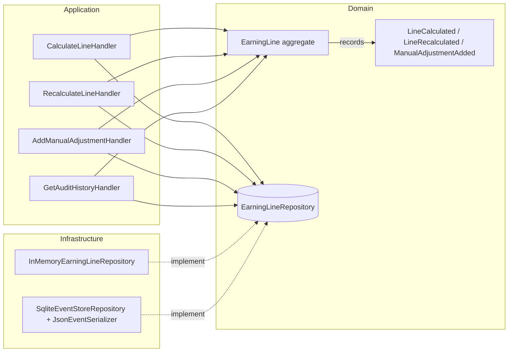

# Payroll Earning Line Adjustments — Proof of Concept

[](https://github.com/volodymyr-chudovskyi/payroll-adjustments-poc/actions/workflows/ci.yml)

A domain model for the history of manual adjustments to an automatically calculated payroll earning line.

The business rules, in short:

- The system calculates an earning line and may recalculate it while it has no manual corrections.
- A payroll specialist can add corrections: a positive or negative amount with a mandatory comment.
- Corrections are append-only — never edited or deleted; a mistake is fixed by a compensating correction.
- Once the first correction lands, the system value is frozen: recalculation attempts are ignored forever.
- The current value and the full audit history are available at any point.

## Quick start

With Docker (no local PHP needed):

```sh
docker compose run --rm app composer install
docker compose run --rm app composer check   # pint + phpstan + tests
docker compose run --rm app composer demo    # replay the reference scenario
docker compose run --rm app composer repl    # interactive session (see below)
```

With local PHP 8.5:

```sh
composer install
composer check
composer demo
composer repl
```

## Demo

`composer demo` replays the reference scenario from the assignment end to end — through the command handlers and the SQLite event store — and prints the audit history:

```
Step 1  System calculates the line                                            $1,000.00
Step 2  Source data changes, system recalculates                              $1,050.00
Step 3  Specialist adds a manual correction (-$45.55)                         $1,004.45
Step 4  System attempts to recalculate (ignored: manual correction exists)    $1,004.45
Step 5  Specialist adds a second correction (+$100.10)                        $1,104.55
Step 6  Specialist adds a third correction (-$0.10)                           $1,104.45
Step 7  Specialist adds a fourth correction (-$0.20)                          $1,104.25
Step 8  Specialist adds a compensating correction (+$0.20)                    $1,104.45

Final audit history
  System value (frozen)                                                       $1,050.00
  Adjustment 1: Employee declined dental benefit; reversing deduction           -$45.55
  Adjustment 2: Late correction: missed approved overtime bonus                +$100.10
  Adjustment 3: Minor rounding adjustment                                        -$0.10
  Adjustment 4: Second minor rounding adjustment                                 -$0.20
  Adjustment 5: Correcting mistake in adjustment #4                              +$0.20
  Current (new) value                                                         $1,104.45
```

The same table is pinned as the canonical acceptance test:
[`tests/Feature/AcceptanceScenarioTest.php`](tests/Feature/AcceptanceScenarioTest.php).

## Interactive mode

`composer repl` starts an interactive session against the SQLite event store, so the rules can be explored by hand:

```
$ docker compose run --rm app composer repl
Payroll earning line REPL. Type 'help' for commands, 'exit' to quit.
payroll> calculate 1000.00
Line calculated: $1,000.00
payroll> recalculate 1050.00
Line recalculated: $1,050.00
payroll> adjust -45.55 Employee declined dental benefit
Adjustment recorded (-$45.55). Current value: $1,004.45
payroll> recalculate 1200.00
Recalculation ignored: the line is frozen by manual corrections. Current value: $1,004.45
payroll> audit
Audit history
  System value (frozen)                                                       $1,050.00
  Adjustment 1: Employee declined dental benefit                                -$45.55
  Current (new) value                                                         $1,004.45
```

## Architecture

The aggregate is event-sourced with a hand-rolled mechanism of ~30 lines (`recordThat` / `apply` / `reconstitute`) — no event-sourcing library. The assignment is fundamentally about an immutable audit trail, and an append-only event stream *is* that audit trail, so the write model and the audit requirement collapse into one concept. Rolling it by hand keeps the whole mechanism inspectable: there is no framework underneath to explain.



Layer rules are enforced by [architecture tests](tests/Arch/ArchitectureTest.php): the domain depends only on itself, the application layer never touches infrastructure, everything is `strict_types`, domain classes are `final`, value objects are `readonly`.

Decisions worth a closer look (full reasoning in [`docs/adr`](docs/adr)):

- **Money is an integer number of cents** — never floats in payroll. `$1,104.45` is `110445`. ([ADR-0002](docs/adr/0002-money-as-integer-minor-units.md))
- **An ignored recalculation is a silent no-op**, not an exception and not an event. The assignment's expected audit history contains no trace of the ignored attempt (step 4), so recording one would diverge from the spec. The trade-off — losing observability of ignored attempts — is deliberate and documented. ([ADR-0001](docs/adr/0001-lightweight-event-sourcing.md))
- **The frozen base is the *last* system value before the first correction** ($1,050.00, not the initial $1,000.00) — pinned by a dedicated unit test.
- **No framework** — the assignment says a framework isn't needed, and it isn't: the deliverable is a domain model. In a Laravel application this `src/` drops in unchanged: bind `EarningLineRepository` in a service provider, wrap the handlers in artisan commands or controllers. ([ADR-0003](docs/adr/0003-no-framework.md))
- **Optimistic concurrency for free**: the event store's `PRIMARY KEY (aggregate_id, version)` turns a lost-update race into a `ConcurrencyConflict` — covered by a test.

## Testing

```sh
composer test            # full suite, parallel
composer test:coverage   # line coverage, fails under 90%
composer test:types      # type coverage, fails under 100%
composer test:mutate     # mutation testing of the domain, fails under 85%
composer analyse         # phpstan, level max
composer check           # format + analyse + test
```

Current numbers: **62 tests / 148 assertions**, **99.5% line coverage**, **100% type coverage**, **96.2% mutation score** on the domain (the two surviving mutants are equivalent: an extra random byte truncated by formatting, and an `instanceof` arm unreachable for any existing event type).

The suite is layered the way the code is: unit tests around every domain rule (including the edge cases — empty comment, zero amount, formatting boundaries), feature tests for the acceptance scenario, persistence round-trips and concurrency, and architecture tests for the dependency rules. Developed test-first; each commit is a completed red-green-refactor cycle.

Pest 5 runs on the PHPUnit 13 engine, so the "PHPUnit" requirement is satisfied — Pest is a test runner and DSL on top of PHPUnit, not a replacement.

## Assumptions

- Single currency (USD), two decimal places; `int64` cents make overflow a non-issue at payroll magnitudes.
- A zero-amount correction is rejected — it cannot "correct" anything and would only pollute the audit trail.
- A negative current value is allowed — clawbacks can legitimately exceed the base.
- Corrections are identified by `AdjustmentId` and displayed by position ("Adjustment #4" in the reference comment refers to the fourth entry).
- Who acts (system vs. specialist, authn/authz) is out of scope; events carry no actor.
- Timestamps are recorded in UTC; event order is defined by the stream version, not wall-clock time.
- Concurrency control is optimistic (version conflict → `ConcurrencyConflict`); retry policy is the caller's concern.

## What I would do differently in production

- A battle-tested money library (`brick/money`) and UUID library (`ramsey/uuid`) instead of the deliberately minimal local implementations.
- Snapshots and projections (read models) once streams grow; event upcasting for schema evolution.
- A real message bus with middleware (transactions, retries, idempotency) instead of directly invoked handlers.
- Recording ignored recalculation attempts as a separate non-audit event stream for observability.
- MySQL for the event store (the SQL here is deliberately engine-agnostic; SQLite keeps the PoC dependency-free).

## How I used AI

This project was built with an AI coding agent (Claude), directed step by step — which mirrors how I think engineering with AI should work: the agent executes, the human owns the process and the result.

- The TDD loop was non-negotiable: the acceptance test from the assignment table was written first, then every rule was driven by a failing unit test. The agent wrote tests before implementation in every cycle.
- The quality gates are what make AI-generated code trustworthy here: PHPStan at level max, architecture tests pinning the dependency rules, and mutation testing — which caught real assertion gaps (untested exception messages, unpinned UUID version bits, a boundary bug class in money formatting) that line coverage alone would have hidden.
- Mutation testing also exposed a genuine design flaw mid-development: the first version of optimistic locking read the current version from the database at save time, which cannot detect concurrent writers. The concurrency test caught it; the fix moved version tracking into the aggregate.
- Every commit was reviewed before it was made; the commit history is the actual development narrative, not a squashed afterthought.

## License

MIT
